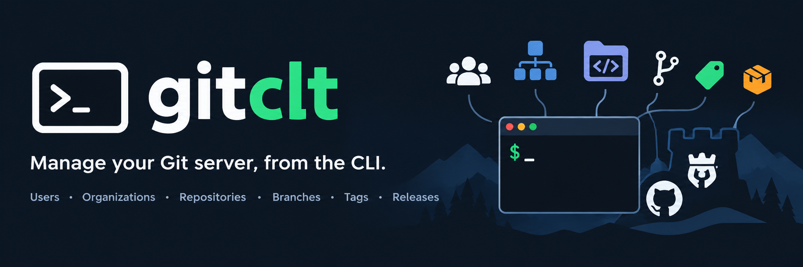

# gitclt
___
`gitclt` is a CLI client for Forgejo, GitHub (github.com, as well as GitHub Enterprise Server) and Bitbucket Cloud.<br>
It is meant to handle the usual git server tasks from the command line: repositories, branches, tags, releases, users, orgs, etc.<br>
It is a front-end to [gitoperationslib](https://github.com/jeanfrancoisgratton/gitoperationslib), which does the actual talking to the forges. Forgejo servers must run version 11.0.10 or later.

What is currently implemented:
- a connections registry (multiple servers, multiple accounts, one default connection)
- repositories: list, info, create, delete
- users: whoami, get, list, create, edit, delete
- organizations: list, get, create, edit, rename, delete, membership (list, check, remove)

**TABLE OF CONTENTS**<br>

[Build / Install requirements](#build-install-requirements)

[Using the tool](#using-the-tool)
- [The connections registry](#connections)
- [Command summary](#command-summary)
- [Shell completion](#completion)

[Developer notes: writing a new command](#developer-notes)
- [Package layout](#package-layout)
- [Setting up the client](#http-client)
- [Wiring the command](#wiring-the-command)
- [Testing](#testing)

<a id="build-install-requirements"></a>
# Build/install requirements

## Install from source
1. Clone/fork the repo: either `git clone https://github.com/jeanfrancoisgratton/gitclt` or `git clone https://git.famillegratton.net:3000/devops/gitclt`
2. Ensure that you have the proper GO version, as stated in `src/go.mod`. Run `go version` to check
3. cd to `src`, and then run `./updateBuildDeps.sh`, to ensure that all build dependencies are up to date
4. Run `./build.sh`. By default, the binary will be created in `/opt/bin` (check the directory's permissions ahead of running it). `./build.sh --help` shows the options (binary name, output directory, dry-run)

## Build your own package
All format/distro-specific packaging scripts live under their own directories: `__alpine` (APK), `__debian` (DEB), `__redhat` (RPM), `__archlinux` (PKGBUILD), `__windows`.

<a id="using-the-tool"></a>
# Using the tool

<a id="connections"></a>
## The connections registry
Before doing anything against a server, you need at least one connection. Connections live in `$HOME/.config/JFG/gitclt/connections.json` (see [docs/connections.json](docs/connections.json) for a sample).<br>
The file looks a lot like `$HOME/.docker/config.json`:

```json
{
	"auths": {
		"CONNECTION1": {
			"url": "https://SERVER1:PORT1",
			"token": "...",
			"username": "myuser",
			"password": "...",
			"servertype": "forgejo"
		}
	},
	"default_connection": "CONNECTION1"
}
```

- `servertype` is `forgejo`, `github` or `bitbucket`
- `url` is the server URL, as you'd type it in a browser. The API URL is derived from it:
  - Forgejo: `URL/api/v1` (`url` may also be a sub-path install, ex: `https://example.com/forgejo`)
  - github.com: `https://api.github.com`
  - any other host with `servertype: github` is treated as GitHub Enterprise Server: `URL/api/v3`
  - bitbucket.org: `https://api.bitbucket.org/2.0`. Only Bitbucket Cloud is supported (not Bitbucket Data Center / Server); any other host with `servertype: bitbucket` is used as the API root itself (ex: a proxy)
- You need either a token, or a username + password pair. When both are present, **the token always wins**
- GitHub no longer accepts passwords on its REST API: a GitHub connection needs a token
- Bitbucket accepts two kinds of tokens in `token`:
  - a workspace / project / repository access token (`ATCTT...`): sent as a bearer token, no username needed
  - an Atlassian API token with Bitbucket scopes (`ATATT...`): Bitbucket only accepts it with basic auth, so `username` **must** be your Atlassian account e-mail
  - without a token, `username` + `password` (an API token or an app password) are used as is
- On Bitbucket, repository owners are **workspaces**. Bitbucket Cloud has no releases, no tag protection, and no issue tracker anymore: those commands will report that the feature is not supported
- Tokens and passwords are encrypted when the tool writes the file. You can still hand-edit the file with cleartext secrets; they will get encrypted the next time the tool saves the registry
- A hand-edited, invalid connection is not rejected on load: `gitclt conn list` flags it, and you can fix it with `gitclt conn edit`, or remove it with `gitclt conn rm`
- The first connection you add becomes the default one

<a id="command-summary"></a>
## Command summary

Notation: `<ARG>` is a positional argument, `[...]` is optional, and the aliases are in parentheses.<br>
The same aliases work everywhere: `list` (`ls`), `get` / `info`, `create` (`add`), `edit` (`modify`, `update`), `delete` (`rm`, `remove`).

### Global flags
These work on every command:

| Flag                            | Meaning                                                      |
|---------------------------------|--------------------------------------------------------------|
| `-c`, `--connection CONNECTION` | Use this connection instead of the default one               |
| `-q`, `--quiet`                 | Output will be as quiet as possible                          |
| `-D`, `--debug`                 | Debug mode (also lets the password prompts read from a pipe) |

### Other commands
| Command                       | Description                                       |
|-------------------------------|---------------------------------------------------|
| `gitclt version`              | Shows the software version                        |
| `gitclt whoami`               | Shortcut for `gitclt user whoami`                 |
| `gitclt completion bash\|zsh` | Generates a shell completion script (see [below](#completion)) |

### Connections: `gitclt conn` (alias: `connection`)
| Command                                   | Description                                                                 |
|-------------------------------------------|-----------------------------------------------------------------------------|
| `gitclt conn list` (`ls`)                 | Lists all connections in the registry                                       |
| `gitclt conn info [<CONNECTION>...]` (`explain`) | Shows the details of the given connections; no argument means the default one |
| `gitclt conn add <CONNECTION>` (`create`) | Adds a connection (interactive)                                             |
| `gitclt conn edit <CONNECTION>` (`modify`, `update`) | Edits a connection in-place; ENTER keeps the current value, `-` clears a secret |
| `gitclt conn delete <CONNECTION>` (`rm`, `remove`) | Removes a connection                                               |
| `gitclt conn default [<CONNECTION>]`      | Shows the default connection, or sets it                                    |

### Repositories: `gitclt repo` (alias: `repository`)
| Command                                        | Description                                                         |
|------------------------------------------------|---------------------------------------------------------------------|
| `gitclt repo list [-o OWNER] [-s\|-S SORT] [-j]` (`ls`) | Lists all repositories visible to the connection's user. `-o` limits the list to a user / organization (a workspace on Bitbucket); `-s` sorts on a column in descending order, `-S` in ascending order (its first letter is enough: `i`d, `o`wner, `r`epository, `c`reated, `u`pdated; default: descending on ID, or on Repository on Bitbucket, which has no repository IDs); `-j`, `--json` outputs JSON; `-q` outputs only the `owner/name` of each repo. The sort order applies to all three outputs |
| `gitclt repo info -o OWNER [-j] <REPO>` (`get`) | Shows the details of a repository |
| `gitclt repo create -o OWNER [flags] <REPO>` (`add`) | Creates a repository. `--description`, `--default-branch` (default: `develop`), `--public=false` for a private repo, `--template`, `--initialize` (creates it with a `.gitignore` and a `README.md`) |
| `gitclt repo delete -o OWNER <REPO>` (`rm`, `remove`) | Deletes a repository |

### Users: `gitclt user`
Except `whoami`, these need admin rights, and only work on Forgejo.

| Command                                        | Description                                                         |
|------------------------------------------------|---------------------------------------------------------------------|
| `gitclt user whoami [-x] [-j]` (`who`)          | Shows the connection's user; `-x`, `--extended` adds the forge-specific fields |
| `gitclt user get [-x] [-j] <USER>` (`info`)     | Shows a user |
| `gitclt user list [-j]` (`ls`)                  | Lists all users on the forge |
| `gitclt user create -e EMAIL [flags] <USER>` (`add`) | Creates a user; the password is prompted for, or read from `-p`, `--password-file FILE`. Also: `-f`, `--fullname`, `-d`, `--description`, `-w`, `--website`, `-l`, `--location`, `-v`, `--visibility public\|limited\|private`, `-a`, `--admin`, `-r`, `--restricted`, `-m`, `--must-change-passwd` (server default when omitted), `-s`, `--send-notification` |
| `gitclt user edit [flags] <USER>` (`modify`, `update`) | Edits a user; **only the flags passed are sent**. Same text flags as `create`, plus `-P`, `--passwd` (prompt) or `-p`, `--password-file`, `--active`, `--prohibit-login`, `--allow-create-org`, `--max-repos N`. Booleans are revoked with `=false` (ex: `--admin=false`), and `""` clears a text field |
| `gitclt user delete [-p] [-y] <USER>` (`rm`, `remove`) | Deletes a user, after confirmation (`-y`, `--yes` skips it); `-p`, `--purge` also deletes everything the user owns |

### Organizations: `gitclt org` (alias: `organization`)
Forgejo only. Some commands are self-service; the others need admin rights, or to be an owner of the organization.

| Command                                        | Description                                                         |
|------------------------------------------------|---------------------------------------------------------------------|
| `gitclt org list [-j] [<USER>]` (`ls`)          | Lists the organizations `<USER>` belongs to (default: yourself) |
| `gitclt org listall [-j]`                       | Lists all organizations on the forge (needs admin rights) |
| `gitclt org get [-j] <ORG>` (`info`)            | Shows an organization |
| `gitclt org create [flags] <ORG>` (`add`)       | Creates an organization. `-o`, `--owner USER` creates it for someone else (needs admin rights); `-f`, `--fullname`, `-d`, `--description`, `-w`, `--website`, `-e`, `--email`, `-l`, `--location`, `-v`, `--visibility public\|limited\|private`, `-t`, `--repo-admin-team-access` (repository admins can change team access) |
| `gitclt org edit [flags] <ORG>` (`modify`, `update`) | Edits an organization, with the same flags as `create` (except `--owner`); **only the flags passed are sent**. Booleans are revoked with `=false`, and `""` clears a text field |
| `gitclt org rename <ORG> <NEW-NAME>` (`mv`)     | Renames an organization |
| `gitclt org delete [-y] <ORG>` (`rm`, `remove`) | Deletes an organization, after confirmation (`-y`, `--yes` skips it) |
| `gitclt org members [-j] <ORG>`                 | Lists the members of an organization |
| `gitclt org ismember <ORG> <USER>`              | Tells whether `<USER>` is a member of `<ORG>`; a missing `<ORG>` is an error, not a "no" |
| `gitclt org removemember [-y] <ORG> <USER>` (`rmmember`) | Removes `<USER>` from `<ORG>`, after confirmation (`-y`, `--yes` skips it) |

<a id="completion"></a>
## Shell completion
```bash
# Bash: current session, then for good
source <(gitclt completion bash)
gitclt completion bash | sudo tee /etc/bash_completion.d/gitclt > /dev/null

# Zsh: any directory in your $fpath
gitclt completion zsh > ~/.zsh/_gitclt
```

<a id="developer-notes"></a>
# Developer notes: writing a new command

<a id="package-layout"></a>
## Package layout
`gitclt` is a CLI front-end to [gitoperationslib](https://github.com/jeanfrancoisgratton/gitoperationslib): all forge API calls go through that library.
The code lives under `src/`, and dependencies only flow downward:

```
cmd/            cobra commands; parses flags, calls the feature package, prints the error if any
  │
repositories/   feature packages, one per resource (users/, organizations/, later teams/, branches/, ...)
users/          calls the library, formats the output (table / JSON / quiet)
organizations/
  │
forge/          opens a gitoperationslib client on a connection; converts library errors
  │
connections/    the connections registry; resolves a connection name into an ActiveConnection
shared/         global flag values (QuietOutput, ConnectionName), FetchAll(), PrintJSON(), VisibilityFlag
testutil/       test helpers only (fake Forgejo, throw-away registry, prompt answering); never in the binary
```

A feature package never reads `connections.json`, never decides how to authenticate, and never sends HTTP requests by itself.
If the library lacks something a command needs, the fix belongs in gitoperationslib, not in `gitclt`.

<a id="http-client"></a>
## Setting up the client

### 1. Connect
```go
ctx := context.Background()
c, err := forge.Connect(ctx, shared.ConnectionName)
if err != nil {
	return err
}
```
`forge.Connect()` takes a connection name; an empty name means the default connection. Always pass
`shared.ConnectionName`, which holds the `-c`/`--connection` flag value. It returns a `*cerr.CustomError`, so you can return it as-is.

Behind the scenes:
- `connections.ResolveConnection()` loads the registry, picks the connection (and errors out if it's unknown, invalid, or if there's no default connection), and decides the authentication method (token over username/password)
- `forge.Connect()` then opens the matching library client:
  - Forgejo: `forgejo.New()` with `forgejo.Token()` or `forgejo.BasicAuth()`. **This already contacts the server**: it reads its version, and refuses anything older than the library's minimum (11.0.10)
  - GitHub: `github.New()` with the token; any host other than `github.com` is treated as GitHub Enterprise Server (`github.WithEnterpriseURL()`, the library appends `/api/v3/`). This makes no request
  - Bitbucket: `bitbucket.New()` with `bitbucket.Token()` (access tokens) or `bitbucket.BasicAuth()` (username/password) or `bitbucket.APIToken()` (Atlassian API tokens, `ATATT...`, which Bitbucket refuses as bearer tokens: the connection's username must be the Atlassian e-mail); any host other than `bitbucket.org` is passed as is to `bitbucket.WithBaseURL()`. This makes no request
- all of them get an `http.Client` with connect / TLS handshake / response headers timeouts (`forge.FastFailTimeout`, 30s by default), and `gitclt` as User-Agent. There is no global request timeout, so long transfers (ex: release assets) are not cut; use a context if you need a deadline

You get back a `*forge.Client`:
- it embeds `gol.Client` (`gol` being the usual alias for `github.com/jeanfrancoisgratton/gitoperationslib`), so the library's areas are called directly on it: `c.Repos()`, `c.Branches()`, `c.Tags()`, `c.Releases()`, `c.PullRequests()`, `c.Issues()`, `c.Labels()`, `c.Milestones()`, `c.Webhooks()`, ...
- `c.Connection` is the resolved `connections.ActiveConnection`: its `Name` is handy in output messages, its `Username` in user-scoped calls

See the [gitoperationslib README](https://github.com/jeanfrancoisgratton/gitoperationslib#readme) for the full API of each area.

### 2. Errors
The library returns plain `error`s; commands return `*cerr.CustomError`. Convert with `forge.Error(title, err)`, which also copies the HTTP status (if any) into `Code`:

```go
repo, gerr := c.Repos().Get(ctx, owner, name)
if gerr != nil {
	return forge.Error("Unable to fetch the repository", gerr)
}
```

Test the library error **before** converting it, when one case is normal for your command:
```go
repo, gerr := c.Repos().Get(ctx, owner, name)
switch {
case gol.IsNotFound(gerr):
	// no such repository
case errors.Is(gerr, gol.ErrNotSupported):
	// this backend cannot do this
case gerr != nil:
	return forge.Error("Unable to fetch the repository", gerr)
}
```
Also available: `gol.IsUnauthorized()`, `gol.IsForbidden()`, `gol.StatusCode()`, and `*gol.APIError` (via `errors.As`) for the forge's message and details.

### 3. Lists: always go through `shared.FetchAll()`
List methods return **one page** (`gol.Page[T]`). Calling them once only gives you the first page, without any warning. `shared.FetchAll()` wraps `gol.All()`, which follows the pages for you:

```go
repos, lerr := shared.FetchAll(ctx, func(ctx context.Context, o gol.ListOptions) (gol.Page[gol.Repo], error) {
	return c.Repos().List(ctx, "", o)
})
if lerr != nil {
	return forge.Error("Unable to list repositories", lerr)
}
```
- it stops at the first error, and returns it
- page size: `shared.ListPageSize` (50), which is safe on all forges (Forgejo's maximum is a server setting, 50 by default; GitHub's and Bitbucket's are 100)
- a list of users renders with `users.RenderUserTable()`, whoever it comes from (`org members`, later team members, ...)

### 4. Creating, editing, deleting
The library's option structs use the library's own types; nil pointer fields in `Edit...Options` mean "leave unchanged" (`gol.Ptr()` builds a pointer from a value):

```go
repo, gerr := c.Repos().Create(ctx, gol.CreateRepoOptions{Name: name, Visibility: gol.VisibilityPrivate})
if gerr != nil {
	return forge.Error("Unable to create the repository", gerr)
}

_, gerr = c.Repos().Edit(ctx, owner, name, gol.EditRepoOptions{Archived: gol.Ptr(true)})

gerr = c.Repos().Delete(ctx, owner, name)
```

A deadline on a single operation:
```go
ctx, cancel := context.WithTimeout(context.Background(), 2*time.Minute)
defer cancel()
```

### 5. Forge differences
The library hides most differences behind its interfaces. When a feature only exists on one backend:
- `c.Capabilities().Has(gol.CapAdmin)` (or a type assertion such as `c.Client.(gol.Admin)`) tells you whether it's available
- otherwise, the call returns `gol.ErrNotSupported`: report it, don't work around it
- `c.Backend()` returns `gol.BackendForgejo`, `gol.BackendGitHub` or `gol.BackendBitbucket`

Some fields are not reported by every backend (ex: `gol.Repo.Empty` is always false on GitHub, `gol.Repo.ID` is always 0 on Bitbucket); check the library's doc comments before relying on one.
On Bitbucket, users have no public login name: user fields hold the account's nickname.

<a id="wiring-the-command"></a>
## Wiring the command
- The feature function returns a `*cerr.CustomError`; the cobra command prints it (see `cmd/repo_commands.go`)
- Honour the output flags: `shared.QuietOutput` (bare output, one item per line), and a `--json` flag when it makes sense (`shared.PrintJSON()`). The JSON output is the library's types as-is (Go field names, ex: `FullName`)
- `-c`/`--connection`, `-q` and `-D` are persistent flags on the root command: a new command group gets them for free
- Feature functions that fetch data take a `displayoutput bool`: `false` returns the data without printing anything, so other packages can reuse the call
- Edit commands only send the flags that were passed: hand `cmd.Flags().Changed` to the feature function, which sets the matching `gol.Edit...Options` pointer fields (see `organizations/edit.go`)
- A `--visibility` flag is a `shared.VisibilityFlag` (it refuses anything but `public`, `limited`, `private`); register `completeVisibility` as its completion function
- Conventions for the cobra files (`cmd/*_commands.go`), checked in part by `cmd/root_test.go`:
  - `Short` starts with a third-person verb ("Lists...", "Deletes..."), and states "(needs admin rights)" / "(Forgejo only)" when it applies
  - `Example` lines start with two spaces; positional arguments are written `<ARG>`, flag values bare (`-c CONNECTION`), and flags come before the arguments
  - every leaf command declares `Args`; aliases follow the table in the [command summary](#command-summary)
  - every `--flag` mentioned in `Long` or `Example` must exist on that command, and every documented command line must be listed in `TestCommandTree`

<a id="testing"></a>
## Testing
An in-process `httptest` server stands in for the forge, and the registry is a temporary one. The `testutil` package does the plumbing:
- `testutil.Forgejo(t, routes)` starts a fake Forgejo (it already answers `GET /api/v1/version`, which `forgejo.New()` checks) and makes it the default connection; any route not listed answers 404
- `testutil.Reply(json)`, `testutil.Status(code)` and `testutil.Record(t, &bodies, status, json)` are ready-made handlers; `Record` keeps the JSON body of each request, to check what was (and was not) sent
- `testutil.WriteRegistry(t, json)` writes a throw-away registry under a temporary `HOME` (`""`: no connection at all)
- `testutil.Run(t, f, answers...)` captures what `f` prints (colour codes stripped), and answers its prompts in turn
- `testutil.Set(t, &flagVar, value)` changes a package-level flag variable for the duration of the test only
- in `cmd/`, `execute(t, args, answers...)` runs a whole command line, and resets every flag afterwards

For the other backends (see `forge/client_test.go`):
- a `github` test server is treated as GitHub Enterprise Server: the calls are under `/api/v3/`
- a `bitbucket` test server is used as the API root: set `url` to `SERVER/2.0`, and answer under `/2.0/` (ex: `GET /2.0/user/workspaces`, `GET /2.0/repositories/WORKSPACE`)

`build.sh` runs `go vet ./...` and `go test ./...` before building.
