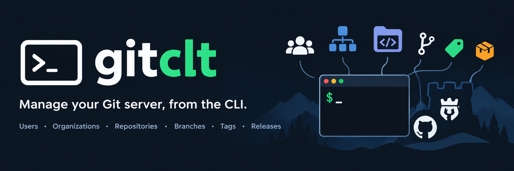

# gitclt
___
`gitclt` is a CLI client for Forgejo, GitHub (github.com, as well as GitHub Enterprise Server) and Bitbucket Cloud.<br>
It is meant to handle the usual git server tasks from the command line: repositories, branches, tags, releases, users, orgs, etc.<br>
It is a front-end to [gitoperationslib](https://github.com/jeanfrancoisgratton/gitoperationslib), which does the actual talking to the forges. Forgejo servers must run version 15.0.0 or later.

What is currently implemented:
- a connections registry (multiple servers, multiple accounts, one default connection)
- repositories: list, info, create, delete
- users: whoami, get, list, create, edit, delete; your own e-mail addresses, SSH keys and avatar
- organizations: list, get, create, edit, rename, delete, membership (list, check, remove), avatar
- teams: list, get, create, edit, delete, membership (list, check, add, remove), repository access (list, add, remove)
- webhooks: your own, the server's (system and default), a repository's, an organization's
- from inside a clone, the repository and its owner are read from the remotes: see [working from inside a clone](#working-from-inside-a-clone)

**TABLE OF CONTENTS**<br>

[Build / Install requirements](#build-install-requirements)

[Using the tool](#using-the-tool)
- [The connections registry](#connections)
- [Command summary](#command-summary)
- [Shell completion](#completion)

[Developer notes: writing a new command](#developer-notes)
- [Package layout](#package-layout)
- [Setting up the client](#http-client)
- [Wiring the command](#wiring-the-command)
- [Testing](#testing)

<a id="build-install-requirements"></a>
# Build/install requirements

## Install from source
1. Clone/fork the repo: either `git clone https://github.com/jeanfrancoisgratton/gitclt` or `git clone https://git.famillegratton.net:3000/devops/gitclt`
2. Ensure that you have the proper GO version, as stated in `src/go.mod`. Run `go version` to check
3. cd to `src`, and then run `./updateBuildDeps.sh`, to ensure that all build dependencies are up to date
4. Run `./build.sh`. By default, the binary will be created in `/opt/bin` (check the directory's permissions ahead of running it). `./build.sh --help` shows the options (binary name, output directory, dry-run)

## Build your own package
All format/distro-specific packaging scripts live under their own directories: `__alpine` (APK), `__debian` (DEB), `__redhat` (RPM), `__archlinux` (PKGBUILD), `__windows`.

<a id="using-the-tool"></a>
# Using the tool

<a id="connections"></a>
## The connections registry
Before doing anything against a server, you need at least one connection. Connections live in `$HOME/.config/JFG/gitclt/connections.json` (see [docs/samples/connections.json](docs/samples/connections.json) for a sample).<br>
The file looks a lot like `$HOME/.docker/config.json`:

```json
{
	"auths": {
		"CONNECTION1": {
			"url": "https://SERVER1:PORT1",
			"token": "...",
			"username": "myuser",
			"password": "...",
			"owner": "myorg",
			"servertype": "forgejo"
		}
	},
	"default_connection": "CONNECTION1"
}
```

- `servertype` is `forgejo`, `github` or `bitbucket`
- `url` is the server URL, as you'd type it in a browser. The API URL is derived from it:
  - Forgejo: `URL/api/v1` (`url` may also be a sub-path install, ex: `https://example.com/forgejo`)
  - github.com: `https://api.github.com`
  - any other host with `servertype: github` is treated as GitHub Enterprise Server: `URL/api/v3`
  - bitbucket.org: `https://api.bitbucket.org/2.0`. Only Bitbucket Cloud is supported (not Bitbucket Data Center / Server); any other host with `servertype: bitbucket` is used as the API root itself (ex: a proxy)
- You need either a token, or a username + password pair. When both are present, **the token always wins**
- GitHub no longer accepts passwords on its REST API: a GitHub connection needs a token
- Bitbucket accepts two kinds of tokens in `token`:
  - a workspace / project / repository access token (`ATCTT...`): sent as a bearer token, no username needed
  - an Atlassian API token with Bitbucket scopes (`ATATT...`): Bitbucket only accepts it with basic auth, so `username` **must** be your Atlassian account e-mail
  - without a token, `username` + `password` (an API token or an app password) are used as is
- `owner` (optional) is the default owner of the repositories the `repo` and `branch` commands work on: a user, an organization, or a Bitbucket workspace. The owner is, in this order: the `-o`, `--owner` flag, the connection's `owner`, its `username` (unless it is an e-mail), and finally whom the server says the credentials belong to
- On Bitbucket, repository owners are **workspaces**, and the `username` is an e-mail: set `owner` to your workspace, or pass `-o` every time. Bitbucket Cloud has no releases, no tag protection, and no issue tracker anymore: those commands will report that the feature is not supported
- On Bitbucket, users are known by display name, nickname, account ID or `{UUID}`, not by workspace nor e-mail: this applies wherever a command takes a user (`--push-users`, `--merge-users`, `pr` reviewers). `gitclt user whoami -x` shows yours; quote a name with spaces
- Two-factor authentication only concerns password logins on Forgejo, as a token needs no code; so a connection storing a token only meets it on `token create` and `token delete`, which Forgejo refuses with a token. The code is passed with `--otp CODE`, or asked for if the server needs one and there is a terminal; without a terminal, the command fails, and tells you to pass `--otp`. A code lasts 30 to 60 seconds: if a long run outlasts it, a new one is asked for, or without a terminal, the run stops when the server refuses the old one. Forgejo's API does not tell which accounts have two-factor authentication, nor lets it be managed
- Tokens and passwords are encrypted when the tool writes the file. You can still hand-edit the file with cleartext secrets; they will get encrypted the next time the tool saves the registry
- A hand-edited, invalid connection is not rejected on load: `gitclt conn list` flags it, and you can fix it with `gitclt conn edit`, or remove it with `gitclt conn rm`
- The first connection you add becomes the default one

<a id="command-summary"></a>
## Command summary

Notation: `<ARG>` is a positional argument, `[...]` is optional, and the aliases are in parentheses.<br>
The same aliases work everywhere: `list` (`ls`), `get` / `info`, `create` (`add`), `edit` (`modify`, `update`), `delete` (`rm`, `remove`).

### Global flags
These work on every command:

| Flag                            | Meaning                                                      |
|---------------------------------|--------------------------------------------------------------|
| `-c`, `--connection CONNECTION` | Use this connection instead of the default one               |
| `-q`, `--quiet`                 | Output will be as quiet as possible                          |
| `-D`, `--debug`                 | Debug mode (also lets the password and two-factor prompts read from a pipe) |
| `--otp CODE`                    | The current two-factor authentication code, for a password login on Forgejo (see [the connections registry](#connections)) |

### Working from inside a clone
`branch`, `branch protection`, `tag`, `release`, `pr`, `history`, `repo info`, `repo edit` and `webhook repo` work out the repository and its owner when run from anywhere inside a clone, like `git` does. `<REPO>` and `-o` can then be left out:

```
cd ~/src/myrepo/some/dir
gitclt tag ls                 # same as: gitclt tag ls -o myorg myrepo
gitclt branch get feature/x
gitclt pr close 12 13
gitclt -c github tag ls       # the same clone, as seen on GitHub
```

- **The connection picks the remote.** Only the remotes on the connection's server count, the SSH host and port being ignored (`ssh.bitbucket.org` is Bitbucket, and `git.example.net:9722` is `https://git.example.net:3000`). A clone with remotes on three forges therefore follows `-c`. If several remotes are on that server, `origin` wins; if none is `origin` and they point to different repositories, the command stops and asks for the name.
- **No match, no guess.** Outside a clone, or with no remote on the connection's server (an SSH host alias, for example), the command stops with `Missing repository`: it never falls back on a repository of the same name elsewhere.
- **`-o` still wins** for the owner. A repository named on the command line keeps the usual owner (`-o`, the connection's owner, your username), unless it is the current clone's: its owner then comes from the remote.
- **Several targets.** `tag rm v1 v2` cannot be told from `tag rm myrepo v1`, so the first of two or more arguments stays the repository, as it always was: `v1` is then looked up as a repository, and nothing is deleted. Use `.` for the current clone's: `gitclt tag rm . v1 v2`, `gitclt release upload . v1.2.0 a.rpm b.deb`, `gitclt pr create . feature/x develop`. This applies wherever a command takes an open-ended list, or an optional last argument. Pull request numbers and webhook IDs are the exception, as a number is not taken for a repository: `gitclt pr close 12 13`, `gitclt webhook repo rm 5 6`. In return, `pr close`, `pr reopen`, `pr reviewers` and `webhook repo delete` cannot designate a repository with a numeric name.
- `repo delete` always needs the name: it is not something to do on an inferred target.
- The confirmation questions of `branch delete` (server side), `tag delete`, `release delete` and `release delete-assets` name the repository, as it may not have been typed.

Each command's `--help` repeats what applies to it.

### Other commands
| Command                       | Description                                       |
|-------------------------------|---------------------------------------------------|
| `gitclt version`              | Shows the software version                        |
| `gitclt whoami`               | Shortcut for `gitclt user whoami`                 |
| `gitclt completion bash\|zsh` | Generates a shell completion script (see [below](#completion)) |

### Connections: `gitclt conn` (alias: `connection`)
| Command                                   | Description                                                                 |
|-------------------------------------------|-----------------------------------------------------------------------------|
| `gitclt conn list` (`ls`)                 | Lists all connections in the registry                                       |
| `gitclt conn info [<CONNECTION>...]` (`explain`) | Shows the details of the given connections; no argument means the default one |
| `gitclt conn add <CONNECTION>` (`create`) | Adds a connection (interactive)                                             |
| `gitclt conn edit <CONNECTION>` (`modify`, `update`) | Edits a connection in-place; ENTER keeps the current value, `-` clears a secret or the owner |
| `gitclt conn delete <CONNECTION>` (`rm`, `remove`) | Removes a connection                                               |
| `gitclt conn default [<CONNECTION>]`      | Shows the default connection, or sets it                                    |

### Repositories: `gitclt repo` (alias: `repository`)
| Command                                        | Description                                                         |
|------------------------------------------------|---------------------------------------------------------------------|
| `gitclt repo list [-o OWNER] [-s\|-S SORT] [-j]` (`ls`) | Lists all repositories visible to the connection's user (the connection's default owner does not apply here). `-o` limits the list to a user / organization (a workspace on Bitbucket); `-s` sorts on a column in descending order, `-S` in ascending order (its first letter is enough: `i`d, `o`wner, `r`epository, `c`reated, `u`pdated; default: descending on ID, or on Repository on Bitbucket, which has no repository IDs); `-j`, `--json` outputs JSON; `-q` outputs only the `owner/name` of each repo. The sort order applies to all three outputs |
| `gitclt repo info [-o OWNER] [-j] [<REPO>]` (`get`) | Shows the details of a repository |
| `gitclt repo create [-o OWNER] [flags] <REPO>` (`add`) | Creates a repository. `--description`, `--default-branch` (default: `develop`, where the forge can set it: GitHub cannot at creation, and uses your account's or organization's setting; Bitbucket only can with `--initialize`, as an empty repository has no branch yet; passing the flag anyway is refused there), `--public=false` for a private repo, `--template`, `--initialize` (creates it with a `.gitignore` and a `README.md`) |
| `gitclt repo delete [-o OWNER] [-y] <REPO>` (`rm`, `remove`) | Deletes a repository, with everything in it, after confirmation (`-y`, `--yes` skips it; without a terminal to ask on, the repository is not deleted unless `-y` is passed) |
| `gitclt repo edit [-o OWNER] [flags] [<REPO>]` (`modify`, `update`) | Edits a repository; **only the flags passed are sent**: `--name` (renames it), `--description`, `--website`, `--default-branch`, `--public` (`=false` makes it private), `--archived` (`=false` unarchives it), `--template`. Booleans are revoked with `=false`, and `""` clears a text field. Bitbucket cannot archive a repository, nor make it a template |

### Users: `gitclt user`
`whoami` and the `email`, `sshkey` and `avatar` commands act on the connection's user, and need no admin rights. All the others need admin rights, and only work on Forgejo.

| Command                                        | Description                                                         |
|------------------------------------------------|---------------------------------------------------------------------|
| `gitclt user whoami [-x] [-j]` (`who`)          | Shows the connection's user, with their 2FA status (`not reported` when the forge does not tell: always on Forgejo, and on Bitbucket depending on the credentials); `-x`, `--extended` adds the forge-specific fields |
| `gitclt user get [-x] [-j] <USER>` (`info`)     | Shows a user |
| `gitclt user list [-j]` (`ls`)                  | Lists all users on the forge |
| `gitclt user create -e EMAIL [flags] <USER>` (`add`) | Creates a user; the password is prompted for, or read from `-p`, `--password-file FILE`. Also: `-f`, `--fullname`, `-d`, `--description`, `-w`, `--website`, `-l`, `--location`, `-v`, `--visibility public\|limited\|private`, `-a`, `--admin`, `-r`, `--restricted`, `-m`, `--must-change-passwd` (server default when omitted), `-s`, `--send-notification` |
| `gitclt user edit [flags] <USER>` (`modify`, `update`) | Edits a user; **only the flags passed are sent**. Same text flags as `create`, plus `-P`, `--passwd` (prompt) or `-p`, `--password-file`, `--active`, `--prohibit-login`, `--allow-create-org`, `--max-repos N`. Booleans are revoked with `=false` (ex: `--admin=false`), and `""` clears a text field |
| `gitclt user delete [-p] [-y] <USER>` (`rm`, `remove`) | Deletes a user, after confirmation (`-y`, `--yes` skips it); `-p`, `--purge` also deletes everything the user owns |
| `gitclt user wipe [-p] [-n] [-y] <USER>` | Removes a user from all of their organizations and teams, then deletes them. An organization where the user is the only member, and which owns no repositories, is deleted too. Nothing changes if the user is the last owner of an organization that still has other members or repositories, or owns repositories without `-p`, `--purge`. The plan is confirmed once (`-y`, `--yes` skips it); `-n`, `--dry-run` only shows it |
| `gitclt user email list [-j]` (`ls`)            | Lists your e-mail addresses; `-q` outputs only the addresses. The parent command has the alias `emails` |
| `gitclt user email add [-j] <ADDRESS>...` (`create`) | Adds e-mail addresses to your account; GitHub sends each a verification e-mail, and Forgejo does if the server requires it. Not on Bitbucket |
| `gitclt user email delete [-y] <ADDRESS>...` (`rm`, `remove`) | Removes e-mail addresses, after confirmation (`-y`, `--yes` skips it). Nothing changes if one is unknown, or is the primary address. Not on Bitbucket |
| `gitclt user sshkey list [-j]` (`ls`)           | Lists your public SSH keys; `-q` outputs only their titles. The parent command has the aliases `sshkeys`, `ssh` |
| `gitclt user sshkey get [-j] <TITLE>` or `--id ID` (`info`) | Shows one of your public SSH keys, with the key itself |
| `gitclt user sshkey add [-j] <TITLE> <PUBLIC-KEY-FILE>` (`create`) | Adds a public SSH key; the file must hold one public key, and anything else (ex: the private key) is refused before contacting the server |
| `gitclt user sshkey delete [-y] <TITLE>` or `--id ID` (`rm`, `remove`) | Removes a public SSH key, after confirmation (`-y`, `--yes` skips it). GitHub lets several keys share a title: these need `--id` |
| `gitclt user avatar set <IMAGE-FILE>` (`upload`) | Uploads an image (at most 10 MiB and 4096x4096) as your avatar. Forgejo only |
| `gitclt user avatar delete [-y]` (`rm`, `remove`) | Restores the default avatar, after confirmation (`-y`, `--yes` skips it). Forgejo only |

### Organizations: `gitclt org` (alias: `organization`)
Forgejo only. Some commands are self-service; the others need admin rights, or to be an owner of the organization.

| Command                                        | Description                                                         |
|------------------------------------------------|---------------------------------------------------------------------|
| `gitclt org list [-j] [<USER>]` (`ls`)          | Lists the organizations `<USER>` belongs to (default: yourself) |
| `gitclt org listall [-j]`                       | Lists all organizations on the forge (needs admin rights) |
| `gitclt org get [-j] <ORG>` (`info`)            | Shows an organization |
| `gitclt org create [flags] <ORG>` (`add`)       | Creates an organization. `-o`, `--owner USER` creates it for someone else (needs admin rights); `-f`, `--fullname`, `-d`, `--description`, `-w`, `--website`, `-e`, `--email`, `-l`, `--location`, `-v`, `--visibility public\|limited\|private`, `-t`, `--repo-admin-team-access` (repository admins can change team access) |
| `gitclt org edit [flags] <ORG>` (`modify`, `update`) | Edits an organization, with the same flags as `create` (except `--owner`); **only the flags passed are sent**. Booleans are revoked with `=false`, and `""` clears a text field |
| `gitclt org rename <ORG> <NEW-NAME>` (`mv`)     | Renames an organization |
| `gitclt org delete [-y] <ORG>` (`rm`, `remove`) | Deletes an organization, after confirmation (`-y`, `--yes` skips it) |
| `gitclt org members [-j] <ORG>`                 | Lists the members of an organization |
| `gitclt org ismember <ORG> <USER>`              | Tells whether `<USER>` is a member of `<ORG>`; a missing `<ORG>` is an error, not a "no" |
| `gitclt org removemember [-y] <ORG> <USER>` (`rmmember`) | Removes `<USER>` from `<ORG>`, after confirmation (`-y`, `--yes` skips it) |
| `gitclt org avatar set <ORG> <IMAGE-FILE>` (`upload`) | Uploads an image (at most 10 MiB and 4096x4096) as the organization's avatar; a token needs the `write:organization` scope |
| `gitclt org avatar delete [-y] <ORG>` (`rm`, `remove`) | Restores the organization's default avatar, after confirmation (`-y`, `--yes` skips it); a token needs the `write:organization` scope |

### Teams: `gitclt team`
Forgejo only. Teams are addressed by their organization and their name (case-insensitive): `<ORG> <TEAM>`. Forgejo only shows an organization's teams to its members; managing them needs admin rights, or to be an owner of the organization.<br>
A team's access is set either with `-p`, `--permission read|write|admin` (the same level on every unit), or with `-u`, `--units UNIT=LEVEL,...` (a level per unit: `none`, `read` or `write`), never both. The units are `code`, `issues`, `ext_issues`, `wiki`, `ext_wiki`, `pulls`, `releases`, `projects`, `packages`, `actions` (the `repo.` prefix is optional).

| Command                                        | Description                                                         |
|------------------------------------------------|---------------------------------------------------------------------|
| `gitclt team list [-j] <ORG>` (`ls`)            | Lists the teams of an organization |
| `gitclt team get [-j] <ORG> <TEAM>` (`info`)    | Shows a team, with its per-unit access; `gitclt team get <TEAM-ID>` fetches it by ID instead |
| `gitclt team create [flags] <ORG> <TEAM>` (`add`) | Creates a team. `-d`, `--description`, `-p`, `--permission` or `-u`, `--units` (neither: read on every unit), `-a`, `--all-repos` (access to every repository of the organization, current and future), `-r`, `--can-create-repos` |
| `gitclt team edit [flags] <ORG> <TEAM>` (`modify`, `update`) | Edits a team, with the same flags as `create`, plus `-n`, `--name` to rename it; **only the flags passed are sent**. `--permission` / `--units` replace the whole access. Booleans are revoked with `=false`, and `""` clears a text field. The owner team cannot be renamed, nor have its access changed |
| `gitclt team delete [-y] <ORG> <TEAM>` (`rm`, `remove`) | Deletes a team, after confirmation (`-y`, `--yes` skips it); the owner team cannot be deleted |
| `gitclt team members [-j] <ORG> <TEAM>`         | Lists the members of a team |
| `gitclt team ismember <ORG> <TEAM> <USER>`      | Tells whether `<USER>` is a member of the team; a missing `<ORG>` or `<TEAM>` is an error, not a "no" |
| `gitclt team addmember <ORG> <TEAM> <USER>`     | Adds `<USER>` to the team, which also makes them a member of the organization |
| `gitclt team removemember [-y] <ORG> <TEAM> <USER>` (`rmmember`) | Removes `<USER>` from the team, after confirmation (`-y`, `--yes` skips it) |
| `gitclt team repos [-j] <ORG> <TEAM>`           | Lists the repositories the team has access to |
| `gitclt team addrepo <ORG> <TEAM> <REPO>`       | Gives the team access to `<REPO>`, which must belong to `<ORG>` |
| `gitclt team removerepo [-y] <ORG> <TEAM> <REPO>` (`rmrepo`) | Revokes the team's access to `<REPO>`, after confirmation (`-y`, `--yes` skips it); the repository itself is kept |

### Access tokens: `gitclt token` (alias: `tokens`)
The access tokens of the connection's user; Forgejo only, as GitHub and Bitbucket have no API for this. Forgejo refuses token authentication when creating or deleting a token: `create` and `delete` use the connection's password, and ask for it if the connection does not store one (on an account with two-factor authentication, the current code is asked for too, or passed with `--otp CODE`). Forgejo cannot change an existing token: to change its permissions, create a new one, and delete the old one.

| Command                                        | Description                                                         |
|------------------------------------------------|---------------------------------------------------------------------|
| `gitclt token list [-j]` (`ls`)                | Lists the tokens: ID, name, scopes, repositories and last eight characters; `-q` outputs only their names |
| `gitclt token info [-j] <NAME>` or `--id ID` (`get`) | Shows a token. Forgejo only reports the fields of `list`: no dates, and never the secret |
| `gitclt token create -s SCOPE [-r OWNER/REPO] [--otp CODE] [-j] <NAME>` (`add`) | Creates a token, and shows its secret: **this is the only time it can be seen**. `-s`, `--scope` (at least one, passed to the server unchecked; ex: `all`, `read:user`, `write:repository`) and `-r`, `--repo` (limits the token to these repositories) are repeatable, or comma-separated. `-q` outputs only the secret, as long as no prompt is needed: for a script, the connection must store the password |
| `gitclt token delete [--otp CODE] [-y] <NAME>` or `--id ID` (`rm`, `remove`) | Deletes a token, after confirmation (`-y`, `--yes` skips it); you are warned if it looks like the one the connection authenticates with |

### Branches: `gitclt branch`
Every `branch` command takes the repository's owner with `-o`, `--owner OWNER`; without it, the clone's owner is used for its repository (see [working from inside a clone](#working-from-inside-a-clone)), else the connection's default owner (see [the connections registry](#connections)). The local branches are those of the git working copy in the current directory (or one of its parents), read straight from its `.git` directory: the git client does not need to be installed.

| Command                                        | Description                                                         |
|------------------------------------------------|---------------------------------------------------------------------|
| `gitclt branch list [-o OWNER] [-l \| -r \| -a] [-j] [<REPO>]` (`ls`) | Lists the branches: `-l`, `--local` the working copy's (a rough equivalent of `git branch`; `<REPO>` is then optional, and when given, the working copy must be a clone of that repository), `-r`, `--remote` the server's, with their last commit (date and author; not reported by GitHub's branch list), default and protected flags, `-a`, `--all` (the default; it overrides `-l` and `-r`, and `-l -r` together means the same) both, merged by name, with a status seen from the local branch, like `git status`: `in sync`, `ahead N`, `behind N`, `ahead N, behind M` (counted by the server, for the branches that differ only), `unpushed commits` (the local head is unknown to the server, so it cannot count), `local only`, `server only`. If the current directory is not a working copy of `<REPO>`, `--all` shows the server's branches only. The checked out branch is marked with `*` |
| `gitclt branch get [-o OWNER] [-j] [<REPO>] <BRANCH>` | Shows one branch, from both sides when it exists on both: local commit (and whether it is checked out), server commit, last commit (date, author and title), default and protected flags, and the same status as `branch list`. A branch on one side only is still shown; outside of a working copy of `<REPO>`, only the server's side is shown, with the reason |
| `gitclt branch delete [-o OWNER] [-l \| -r \| -a] [-f] [-y] [<REPO>] <BRANCH>...` (`rm`, `del`) | Deletes branches locally (the default), on the server (`-r`, `--remote`), or both (`-a`, `--all`, or `-l -r`; local first). The working copy must be a clone of `<REPO>`, and the local deletion is done by the git client, which refuses the checked out branch and, unless `-f`, `--force`, an unmerged one. Everything is checked before the confirmation (`-y`, `--yes` skips it); the run stops at the first failure, and the branches deleted before it stay deleted |
| `gitclt branch rename [-o OWNER] [-l \| -r \| -a] [<REPO>] <BRANCH> <NEW NAME>` (`mv`) | Renames a branch locally (the default), on the server, or both (local first), with the same `-l`, `-r`, `-a` as `delete`. On the server, open pull requests and protection rules follow the branch; with both sides, the local branch then tracks the server's new name. The local rename is done by the git client |
| `gitclt branch compare [-o OWNER] [-j] [<REPO>] <BASE> <HEAD>` (`cmp`) | Counts, on the server, how far ahead of and behind `<BASE>` `<HEAD>` is (branches, tags or commits), and tells if `<HEAD>` can be merged into `<BASE>` as a fast-forward |

#### Branch protection rules: `gitclt branch protection` (aliases: `protections`, `protect`, `prot`)
A rule protects the branches matching its pattern, a branch name or a glob (`main`, `release/*`); rules are addressed by it. On GitHub, a rule is a branch ruleset: one targeting several patterns is listed, but cannot be addressed.

| Command                                        | Description                                                         |
|------------------------------------------------|---------------------------------------------------------------------|
| `gitclt branch protection list [-o OWNER] [-j] [<REPO>]` (`ls`) | Lists the rules: pattern, required approvals, status checks, signed commits, whether admins are concerned, who may push directly, and whether deletion and force pushes are allowed; `-q` outputs only the patterns |
| `gitclt branch protection get [-o OWNER] [-j] [<REPO>] <PATTERN>` (`info`) | Shows a rule, with the settings this forge has |
| `gitclt branch protection create [-o OWNER] [flags] [<REPO>] <PATTERN>` (`add`) | Creates a rule. Without any flag, it still blocks deleting the matching branches and force-pushing to them; direct pushes stay open to anyone with write access |
| `gitclt branch protection edit [-o OWNER] [flags] [<REPO>] <PATTERN>` (`update`) | Changes only the settings whose flag is passed. Yes/no settings are turned off with `=false`, lists are replaced (`--push-users ''` empties one, `--status-check ''` removes all checks), and `--any-push`, `--any-merge`, `--any-approver` remove an allowlist. A pattern cannot be changed: delete the rule, and create a new one. **On GitHub, the whole ruleset is written back**: its name, its enforcement status (a disabled ruleset becomes active) and any setting gitclt does not know of are overwritten |
| `gitclt branch protection delete [-o OWNER] [-y] [<REPO>] <PATTERN>...` (`rm`, `del`) | Deletes rules, after confirmation (`-y`, `--yes` skips it). Every rule is checked first; the run stops at the first failure, and the rules deleted before it stay deleted |

The flags of `create` and `edit`; a forge refuses the settings it does not have:

| Flag                                           | Setting                                                             | Forges |
|------------------------------------------------|---------------------------------------------------------------------|--------|
| `--approvals N`                                | Approvals required to merge a pull request                          | All |
| `--dismiss-stale`                              | A new push dismisses the earlier approvals (Bitbucket: Premium plans) | All |
| `--status-check NAME` (repeatable)             | A status check that must pass                                       | Forgejo, GitHub |
| `--up-to-date`                                 | The branch must be up to date with the base before merging (GitHub: needs status checks) | Forgejo, GitHub |
| `--signed`                                     | Commits must be signed                                              | Forgejo, GitHub |
| `--apply-to-admins`                            | The rule also applies to administrators (Bitbucket always does: ignored there) | Forgejo, GitHub |
| `--no-push`                                    | Blocks direct pushes: changes go through pull requests. On GitHub, administrators can still push unless `--apply-to-admins` is passed, and `--approvals`, `--dismiss-stale` and `--conversation-resolution` block direct pushes too, whatever the push allowlist says | All |
| `--push-users`, `--push-teams`                 | Only these may push directly (repeatable, or comma-separated). GitHub only exempts teams | All |
| `--merge-users`, `--merge-teams`               | Only these may merge pull requests                                  | Forgejo, Bitbucket |
| `--approver-users`, `--approver-teams`         | Only the approvals of these count                                   | Forgejo |
| `--allow-deletion`, `--allow-force-push`       | Allows deleting the branches, force pushes                          | GitHub, Bitbucket |
| `--linear-history`, `--conversation-resolution` | Forbids merge commits; review conversations must be resolved before merging | GitHub |
| `--block-rejected`, `--block-review-requests`  | A rejected review, a pending official review request blocks the merge | Forgejo |
| `--protected-files`, `--unprotected-files`     | Semicolon-separated globs of files that cannot be changed, that do not need approvals | Forgejo |

### Releases: `gitclt release` (alias: `rel`)
Forgejo and GitHub only: Bitbucket Cloud has no releases. Files (assets) are attached to a tag's **release**, never to the tag itself. Every `release` command takes the repository's owner with `-o`, `--owner OWNER`; without it, the connection's default owner is used.

| Command                                        | Description                                                         |
|------------------------------------------------|---------------------------------------------------------------------|
| `gitclt release upload [-o OWNER] [--create [--draft] [--prerelease]] [-r] [<REPO>] <TAG> <FILE>...` (`up`) | Uploads files to the release of `<TAG>`, each under its base name. Without `--create`, the release must already exist; with it, a missing release is created, titled after the tag (`--draft`, `--prerelease`). The tag must already be on the server: push it first. A name already taken by an asset is an error, unless `-r`, `--replace` is passed: the old asset is then deleted before the upload. Everything (files, release, names) is checked before the first upload; the run stops at the first failed upload, and the files uploaded before it stay. Meant for CI: `gitclt rel up --create -r myrepo v1.2.0 __redhat/*.rpm __debian/*.deb` |
| `gitclt release list [-o OWNER] [-j] [<REPO>]` (`ls`) | Lists the releases, drafts included, in the server's order (newest first): tag, title, type (`release`, `prerelease`, `draft release`, `draft prerelease`), publication date (a draft shows its creation date instead), author and number of assets |
| `gitclt release list-assets [-o OWNER] [-j] [<REPO>] <TAG>` (`lsa`) | Lists the files attached to the release of `<TAG>` (a draft's included): name, size, download count and upload date. Forgejo's external assets (links to files hosted elsewhere) show `external` as their size |
| `gitclt release delete [-o OWNER] [-y] [<REPO>] <TAG>...` (`rm`) | Deletes the releases of one or more tags, drafts included, with their assets. **The tags stay on the server.** Every tag is checked before the confirmation (`-y`, `--yes` skips it), and the missing ones are all reported at once; the run stops at the first failed deletion, and the releases deleted before it stay deleted |
| `gitclt release delete-assets [-o OWNER] [-y] [<REPO>] <TAG> <ASSET>...` (`rma`, `dla`) | Deletes files from the release of `<TAG>`, by asset name (see `release list-assets`). Same checks, confirmation and failure handling as `release delete` |
| `gitclt release edit [-o OWNER] [flags] [<REPO>] <TAG>` (`modify`, `update`) | Edits the release of `<TAG>`, drafts included; only the flags passed are sent: `--title`, `--notes` or `--notes-file FILE` (the release notes, Markdown), `--draft`, `--prerelease`. Booleans are revoked with `=false` (`--draft=false` publishes a draft, provided its tag is on the server), and an empty string clears a text field |
| `gitclt release publish [-o OWNER] [<REPO>] <TAG>...` (`pub`) | Publishes the draft releases of one or more tags; the releases already published are skipped. Every tag is checked first: it must have a release, and be on the server (push it first: publishing would otherwise create it from the release's target); the run stops at the first failure, and the releases published before it stay published |

### Tags: `gitclt tag`
**Remote-only**: these commands work on the server's tags (Forgejo, GitHub and Bitbucket), never on the local working copy's, which are left to git (`git tag`, `git push`, `git fetch`). Every `tag` command takes the repository's owner with `-o`, `--owner OWNER`; without it, the connection's default owner is used. A tag's release, files included, is managed with `gitclt release`.

| Command                                        | Description                                                         |
|------------------------------------------------|---------------------------------------------------------------------|
| `gitclt tag list [-o OWNER] [-j] [<REPO>]` (`ls`) | Lists the server's tags, newest version first (`v0.10.0` before `v0.9.0`): commit, release (Forgejo and GitHub: `release`, `prerelease`, `draft release`...; empty when there is none) and the annotation's first line (not reported by GitHub's tag list: see `tag get`) |
| `gitclt tag get [-o OWNER] [-j] [<REPO>] <TAG>` (`info`) | Shows one tag of the server: full commit SHA, type (`annotated` or `lightweight`) and annotation, release (with its URL) and source archive URLs |
| `gitclt tag create [-o OWNER] [-t TARGET] [-m MESSAGE] [<REPO>] <TAG>` (`add`) | Creates a tag on the server, on `-t`, `--target` (a branch, tag or commit the server knows; the default branch's head when left out). `-m`, `--message` makes an annotated tag, otherwise it is lightweight; Bitbucket always annotates, with its own message. An existing tag is refused. `git fetch` brings the new tag into the local working copy |
| `gitclt tag delete [-o OWNER] [--with-release] [-y] [<REPO>] <TAG>...` (`rm`, `del`) | Deletes tags on the server; the local ones stay. Every tag is checked before the confirmation (`-y`, `--yes` skips it): it must exist, and a tag with a release is refused, unless `--with-release` is passed: the release, with its assets, is then deleted before the tag (Forgejo refuses to delete a tag that has a release, GitHub would leave the release without its tag). The run stops at the first failure, and the tags deleted before it stay deleted. Ex: `gitclt tag rm --with-release -y myrepo v1.2.0-rc1 v1.2.0-rc2` |

### Pull requests: `gitclt pr` (aliases: `pull`, `pullrequest`)
Pull requests on the server; their branches must already be pushed. Every `pr` command takes the repository's owner with `-o`, `--owner OWNER`; without it, the connection's default owner is used. `<NUMBER>` is the pull request's number, with or without a leading `#` (`12` or `#12`).

| Command                                        | Description                                                         |
|------------------------------------------------|---------------------------------------------------------------------|
| `gitclt pr list [-o OWNER] [-s open\|closed\|all] [-j] [<REPO>]` (`ls`) | Lists the pull requests, open ones by default (`closed` includes the merged ones), newest first: number, title, branches (head → base), author, status (`open`, `draft`, `closed`, `merged`) and last update |
| `gitclt pr get [-o OWNER] [-j] [<REPO>] <NUMBER>` (`info`) | Shows one pull request: branches, head commit, author, status, mergeability (`unknown` while GitHub computes it; never reported by Bitbucket), dates, URL, reviews (requested ones included on Forgejo) and description |
| `gitclt pr create [-o OWNER] [-t TITLE] [-b BODY \| -F FILE] [-d] [-r USER,...] [<REPO>] <HEAD> [<BASE>]` (`add`, `open`) | Opens a pull request from `<HEAD>` into `<BASE>` (default: the default branch); both must be on the server. The title defaults to the head branch's name; `-d`, `--draft` opens a draft (on Forgejo, a `WIP: ` title prefix); `-r`, `--reviewers` requests reviews once it is open |
| `gitclt pr edit [-o OWNER] [flags] [<REPO>] <NUMBER>` (`modify`, `update`) | Edits a pull request; only the flags passed are sent: `-t`, `--title`, `-b`, `--body` or `-F`, `--body-file`, `--base`, `-d`, `--draft` (`--draft=false` marks a draft ready for review) |
| `gitclt pr merge [-o OWNER] [-m METHOD] [-d] [--title T] [--message M] [--auto \| --cancel-auto] [<REPO>] <NUMBER>` | Merges a pull request with `-m`, `--method`: `merge` (default), `squash`, `rebase`, `rebase-merge`, `fast-forward-only`, `manually-merged` (GitHub: the first three only). `-d`, `--delete-branch` deletes the head branch once merged. The merge fails if the head moved since gitclt checked it; drafts, closed and conflicting pull requests are refused. `--auto` schedules the merge for when the checks pass (not on Bitbucket), `--cancel-auto` cancels it |
| `gitclt pr close [-o OWNER] [<REPO>] <NUMBER>...` | Closes pull requests without merging them; those already closed or merged are skipped. On Bitbucket, a closed (declined) pull request is final |
| `gitclt pr reopen [-o OWNER] [<REPO>] <NUMBER>...` | Reopens closed pull requests (not on Bitbucket); those already open are skipped, a merged one is refused. Every number is checked before the first change, for `close` too |
| `gitclt pr review [-o OWNER] (-a \| -x \| -n) [-m TEXT] [<REPO>] <NUMBER>` | Reviews a pull request as the connection's user: `-a`, `--approve`, `-x`, `--request-changes` or `-n`, `--comment` (the last two need `-m`). Authors cannot approve, nor request changes on, their own pull requests (Forgejo, GitHub): use another user's connection (`-c`) |
| `gitclt pr reviewers [-o OWNER] [--remove] [<REPO>] <NUMBER> <USER>...` | Requests the review of users on a pull request; `--remove` withdraws the requests |

### Commit history: `gitclt history` (aliases: `log`, `commits`)
The commits of a repository, read from the server like `git log` would: no local clone is needed, and only the commits that were pushed are seen (Forgejo, GitHub and Bitbucket). Every `history` command takes the repository's owner with `-o`, `--owner OWNER`; without it, the connection's default owner is used.

| Command                                        | Description                                                         |
|------------------------------------------------|---------------------------------------------------------------------|
| `gitclt history list [-o OWNER] [-r REF] [-p PATH] [-n COUNT] [--since DATE] [--until DATE] [-j] [<REPO>]` (`ls`) | Lists the commits reachable from `-r`, `--ref` (a branch, tag or commit; default: the default branch), newest first: commit (merge commits marked with `M`), date, author and title. `-p`, `--path` keeps the commits that touched a file or directory; `-n`, `--limit` caps the count (default 30, `0`: the whole history). `--since` and `--until` take a day (`YYYY-MM-DD`, local time; `--until` includes the whole day) or an RFC 3339 timestamp, and are GitHub only. Ex: `gitclt log ls -r develop -p src/history -n 10 myrepo` |
| `gitclt history get [-o OWNER] [-j] [<REPO>] <REF>` (`show`, `info`) | Shows one commit, like `git show --stat`: full SHA, author, committer (when it differs; never reported by Bitbucket), parents, line totals, URL, full message and changed files. `<REF>` is a commit SHA (full or abbreviated), a branch or a tag (their head commit). Forgejo reports no per-file line counts, and does not detect renames |

### Webhooks: `gitclt webhook` (aliases: `webhooks`, `hook`, `hooks`)
A webhook sends an HTTP request to a URL when events happen. There are five kinds, with the same commands, except for what the forges cannot do:

| Kind | What it is | Forges | Rights |
|------|------------|--------|--------|
| `gitclt webhook user` | Your own webhooks, for the events of your repositories | Forgejo | Yours only: an admin gets a 404 on someone else's |
| `gitclt webhook system` | The server's webhooks, for the events of every repository | Forgejo | Site admin |
| `gitclt webhook default` | Templates copied into each repository created afterwards; existing repositories are not affected, and the copies are independent | Forgejo | Site admin |
| `gitclt webhook repo` (`repository`) | A repository's webhooks; `[<REPO>]` is optional from inside a clone | Forgejo, GitHub, Bitbucket | Repository admin |
| `gitclt webhook org` (`organization`) | An organization's webhooks; `<ORG>` is mandatory | Forgejo, GitHub, Bitbucket (workspace) | Organization owner |

In the commands below, `KIND` stands for one of these, with `[<REPO>]` or `<ORG>` right before the other arguments for `repo` and `org`:

| Command                                        | Description                                                         |
|------------------------------------------------|---------------------------------------------------------------------|
| `gitclt webhook KIND list [-j]` (`ls`) | Lists the webhooks; `-q` outputs only their IDs. Not on `default`: Forgejo's API cannot list those, so keep the ID that `create` shows, or read it in the web interface |
| `gitclt webhook KIND get [-j] <ID>` (`info`) | Shows a webhook, with all of its events |
| `gitclt webhook KIND create [flags] <URL>` (`add`) | Creates a webhook delivering to `<URL>`; `-q` outputs only its ID. `-t`, `--type` is the format of the deliveries (Forgejo only; `slack` also serves Mattermost, and needs `--slack-channel`), plus the flags below |
| `gitclt webhook KIND edit [flags] <ID>` (`modify`, `update`) | Edits a webhook; **only the flags passed are changed**. `-u`, `--url`, plus the flags below. The type cannot be changed. Booleans are revoked with `=false`, and `""` clears a text field |
| `gitclt webhook KIND delete [-y] <ID>...` (`rm`, `remove`) | Deletes webhooks, after confirmation (`-y`, `--yes` skips it); all are checked first, and the question shows their URLs |
| `gitclt webhook KIND ping <ID>` (`test`) | Sends a test delivery. `repo` and `org` only; on Forgejo, repositories only, as a push event; not on Bitbucket |

| Flag | Meaning |
|------|---------|
| `-e`, `--event EVENT` | Event to subscribe to (repeatable, or comma-separated). `create` defaults to `push`; on `edit`, it replaces the whole list. `all` is everything: GitHub's wildcard, or the events the library knows elsewhere |
| `-T`, `--content-type TYPE` | Payload encoding: `json` (the default) or `form` (not on Bitbucket) |
| `-b`, `--branch-filter GLOB` | Limits push and branch events to matching branches, such as `{main,release/*}` (Forgejo only) |
| `-a`, `--active` | `=false` keeps the webhook without deliveries |
| `-s`, `--secret`, `--secret-file FILE` | The secret that signs deliveries: prompted for, or read from a file only you can access; never a value on the command line |
| `--auth-header`, `--auth-header-file FILE` | An authorization header sent with deliveries, given the same way (Forgejo only) |
| `--slack-channel`, `--slack-username`, `--slack-icon-url`, `--slack-color` | The settings of a `slack` webhook; on `edit`, those not passed stay as they are |
| `--insecure-ssl` | Does not check the target's TLS certificate, so a third party could read or alter deliveries (GitHub, Bitbucket) |

What to know:
- **A webhook's URL is shown as it is.** For Slack or Mattermost, that URL is a credential. Secrets and authorization headers are never shown: `get` only tells that a header is set.
- **Events.** Forgejo's own names also work (ex: `workflow_run_failure`). `workflow_run` and `workflow_job` stand for all of their statuses, on GitHub and on Forgejo 17 and later. Forgejo drops the names it does not know: the command then says so, and the webhook exists without them.
- **Forgejo 17 deprecates `action_run_*`** in favour of `workflow_run_*`, for removal in a later version. `--event all` follows the server's version: `workflow_*` from 17 on, `action_run_*` below it.
- **What `edit` refuses on Forgejo**, as its API would ignore it and still answer success: changing the `package`, `action_run_*`, `workflow_run_*` and `workflow_job_*` events of an existing webhook, changing its secret, and removing its authorization header. Create a new webhook and delete the old one instead.
- **`system create`** relies on a setting Forgejo's API does not document. If a later version stops honoring it, the command fails, and leaves nothing behind.
- The IDs of `system` and `default` webhooks share one numbering: each kind refuses the other's IDs with a 404.

<a id="completion"></a>
## Shell completion
```bash
# Bash: current session, then for good
source <(gitclt completion bash)
gitclt completion bash | sudo tee /etc/bash_completion.d/gitclt > /dev/null

# Zsh: any directory in your $fpath
gitclt completion zsh > ~/.zsh/_gitclt
```

<a id="developer-notes"></a>
# Developer notes: writing a new command

<a id="package-layout"></a>
## Package layout
`gitclt` is a CLI front-end to [gitoperationslib](https://github.com/jeanfrancoisgratton/gitoperationslib): all forge API calls go through that library.
The code lives under `src/`, and dependencies only flow downward:

```
cmd/            cobra commands; parses flags, calls the feature package, prints the error if any
  │
access_mgmt/    feature packages, one per resource, grouped by area (these folders are not packages themselves):
  users/          they call the library, and format the output (table / JSON / quiet)
  organizations/
  teams/
  tokens/
repo_mgmt/
  repositories/
  webhooks/
branch_mgmt/
  branches/
  protections/
pr_mgmt/
  pullrequests/
history/        (a feature package directly: commit history)
release_mgmt/
  releases/
tag_mgmt/
  tags/
  │
forge/          opens a gitoperationslib client on a connection; converts library errors; decides the repositories' owner
  │
connections/    the connections registry; resolves a connection name into an ActiveConnection
shared/         global flag values (QuietOutput, ConnectionName), FetchAll(), PrintJSON(), VisibilityFlag, InferRepo() and the rest of the .git reading
testutil/       test helpers only (fake Forgejo, throw-away registry, prompt answering); never in the binary
```

A feature package never reads `connections.json`, never decides how to authenticate, and never sends HTTP requests by itself.
If the library lacks something a command needs, the fix belongs in gitoperationslib, not in `gitclt`.

<a id="http-client"></a>
## Setting up the client

### 1. Connect
```go
ctx := context.Background()
c, err := forge.Connect(ctx, shared.ConnectionName)
if err != nil {
	return err
}
```
`forge.Connect()` takes a connection name; an empty name means the default connection. Always pass
`shared.ConnectionName`, which holds the `-c`/`--connection` flag value. It returns a `*cerr.CustomError`, so you can return it as-is.

Behind the scenes:
- `connections.ResolveConnection()` loads the registry, picks the connection (and errors out if it's unknown, invalid, or if there's no default connection), and decides the authentication method (token over username/password)
- `forge.Connect()` then opens the matching library client:
  - Forgejo: `forgejo.New()` with `forgejo.Token()` or `forgejo.BasicAuth()`. **This already contacts the server**: it reads its version, and refuses anything older than the library's minimum (15.0.0)
  - GitHub: `github.New()` with the token; any host other than `github.com` is treated as GitHub Enterprise Server (`github.WithEnterpriseURL()`, the library appends `/api/v3/`). This makes no request
  - Bitbucket: `bitbucket.New()` with `bitbucket.Token()` (access tokens) or `bitbucket.BasicAuth()` (username/password) or `bitbucket.APIToken()` (Atlassian API tokens, `ATATT...`, which Bitbucket refuses as bearer tokens: the connection's username must be the Atlassian e-mail); any host other than `bitbucket.org` is passed as is to `bitbucket.WithBaseURL()`. This makes no request
- all of them get an `http.Client` with connect / TLS handshake / response headers timeouts (`forge.FastFailTimeout`, 30s by default), and `gitclt` as User-Agent. There is no global request timeout, so long transfers (ex: release assets) are not cut; use a context if you need a deadline

Commands working on a repository then call `c.Target(ctx, OwnerOrg, repo)`, usually through their package's `connect()`: an empty `repo` is read from the clone in the current directory (`shared.InferRepo()`), and it returns the owner and the repository to use. In `cmd/`, `splitRepo()` turns the arguments into that optional repository.

You get back a `*forge.Client`:
- it embeds `gol.Client` (`gol` being the usual alias for `github.com/jeanfrancoisgratton/gitoperationslib`), so the library's areas are called directly on it: `c.Repos()`, `c.Branches()`, `c.Tags()`, `c.Releases()`, `c.PullRequests()`, `c.Issues()`, `c.Labels()`, `c.Milestones()`, `c.Webhooks()`, ...
- `c.Connection` is the resolved `connections.ActiveConnection`: its `Name` is handy in output messages, its `Username` in user-scoped calls

See the [gitoperationslib README](https://github.com/jeanfrancoisgratton/gitoperationslib#readme) for the full API of each area.

### 2. Errors
The library returns plain `error`s; commands return `*cerr.CustomError`. Convert with `forge.Error(title, err)`, which also copies the HTTP status (if any) into `Code`:

```go
repo, gerr := c.Repos().Get(ctx, owner, name)
if gerr != nil {
	return forge.Error("Unable to fetch the repository", gerr)
}
```

Test the library error **before** converting it, when one case is normal for your command:
```go
repo, gerr := c.Repos().Get(ctx, owner, name)
switch {
case gol.IsNotFound(gerr):
	// no such repository
case errors.Is(gerr, gol.ErrNotSupported):
	// this backend cannot do this
case gerr != nil:
	return forge.Error("Unable to fetch the repository", gerr)
}
```
Also available: `gol.IsUnauthorized()`, `gol.IsForbidden()`, `gol.StatusCode()`, and `*gol.APIError` (via `errors.As`) for the forge's message and details.

### 3. Lists: always go through `shared.FetchAll()`
List methods return **one page** (`gol.Page[T]`). Calling them once only gives you the first page, without any warning. `shared.FetchAll()` wraps `gol.All()`, which follows the pages for you:

```go
repos, lerr := shared.FetchAll(ctx, func(ctx context.Context, o gol.ListOptions) (gol.Page[gol.Repo], error) {
	return c.Repos().List(ctx, "", o)
})
if lerr != nil {
	return forge.Error("Unable to list repositories", lerr)
}
```
- it stops at the first error, and returns it
- page size: `shared.ListPageSize` (50), which is safe on all forges (Forgejo's maximum is a server setting, 50 by default; GitHub's and Bitbucket's are 100)
- a list of users renders with `users.RenderUserTable()`, whoever it comes from (`org members`, `team members`, ...)

### 4. Creating, editing, deleting
The library's option structs use the library's own types; nil pointer fields in `Edit...Options` mean "leave unchanged" (`gol.Ptr()` builds a pointer from a value):

```go
repo, gerr := c.Repos().Create(ctx, gol.CreateRepoOptions{Name: name, Visibility: gol.VisibilityPrivate})
if gerr != nil {
	return forge.Error("Unable to create the repository", gerr)
}

_, gerr = c.Repos().Edit(ctx, owner, name, gol.EditRepoOptions{Archived: gol.Ptr(true)})

gerr = c.Repos().Delete(ctx, owner, name)
```

A deadline on a single operation:
```go
ctx, cancel := context.WithTimeout(context.Background(), 2*time.Minute)
defer cancel()
```

### 5. Forge differences
The library hides most differences behind its interfaces. When a feature only exists on one backend:
- `c.Capabilities().Has(gol.CapAdmin)` (or a type assertion such as `c.Client.(gol.Admin)`) tells you whether it's available
- otherwise, the call returns `gol.ErrNotSupported`: report it, don't work around it
- `c.Backend()` returns `gol.BackendForgejo`, `gol.BackendGitHub` or `gol.BackendBitbucket`

Some fields are not reported by every backend (ex: `gol.Repo.Empty` is always false on GitHub, `gol.Repo.ID` is always 0 on Bitbucket); check the library's doc comments before relying on one.
On Bitbucket, users have no public login name: user fields hold the account's nickname.

<a id="wiring-the-command"></a>
## Wiring the command
- The feature function returns a `*cerr.CustomError`; the cobra command prints it (see `cmd/repo_commands.go`)
- Honour the output flags: `shared.QuietOutput` (bare output, one item per line), and a `--json` flag when it makes sense (`shared.PrintJSON()`). The JSON output is the library's types as-is (Go field names, ex: `FullName`)
- `-c`/`--connection`, `-q` and `-D` are persistent flags on the root command: a new command group gets them for free
- Feature functions that fetch data take a `displayoutput bool`: `false` returns the data without printing anything, so other packages can reuse the call
- Edit commands only send the flags that were passed: hand `cmd.Flags().Changed` to the feature function, which sets the matching `gol.Edit...Options` pointer fields (see `access_mgmt/organizations/edit.go`)
- A `--visibility` flag is a `shared.VisibilityFlag` (it refuses anything but `public`, `limited`, `private`); register `completeVisibility` as its completion function
- Conventions for the cobra files (`cmd/*_commands.go`), checked in part by `cmd/root_test.go`:
  - `Short` starts with a third-person verb ("Lists...", "Deletes..."), and states "(needs admin rights)" / "(Forgejo only)" when it applies
  - `Example` lines start with two spaces; positional arguments are written `<ARG>`, flag values bare (`-c CONNECTION`), and flags come before the arguments
  - every leaf command declares `Args`; aliases follow the table in the [command summary](#command-summary)
  - every `--flag` mentioned in `Long` or `Example` must exist on that command, and every documented command line must be listed in `TestCommandTree`

<a id="testing"></a>
## Testing
An in-process `httptest` server stands in for the forge, and the registry is a temporary one. The `testutil` package does the plumbing:
- `testutil.Forgejo(t, routes)` starts a fake Forgejo (it already answers `GET /api/v1/version`, which `forgejo.New()` checks) and makes it the default connection; any route not listed answers 404
- `testutil.Reply(json)`, `testutil.Status(code)` and `testutil.Record(t, &bodies, status, json)` are ready-made handlers; `Record` keeps the JSON body of each request, to check what was (and was not) sent
- `testutil.WriteRegistry(t, json)` writes a throw-away registry under a temporary `HOME` (`""`: no connection at all)
- `testutil.Run(t, f, answers...)` captures what `f` prints (colour codes stripped), and answers its prompts in turn
- `testutil.Set(t, &flagVar, value)` changes a package-level flag variable for the duration of the test only
- in `cmd/`, `execute(t, args, answers...)` runs a whole command line, and resets every flag afterwards

For the other backends (see `forge/client_test.go`):
- a `github` test server is treated as GitHub Enterprise Server: the calls are under `/api/v3/`
- a `bitbucket` test server is used as the API root: set `url` to `SERVER/2.0`, and answer under `/2.0/` (ex: `GET /2.0/user/workspaces`, `GET /2.0/repositories/WORKSPACE`)

`build.sh` runs `go vet ./...` and `go test ./...` before building.
